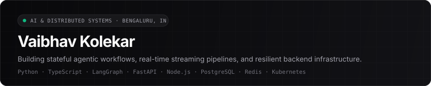

  

  <a href="https://vaibhavk.devs.surf"><b>vaibhavk.devs.surf</b></a>
  &nbsp;·&nbsp;
  <a href="https://linkedin.com/in/vaibhav-k-968883385">LinkedIn</a>
  &nbsp;·&nbsp;
  <a href="https://x.com/va18hav_k">X (Twitter)</a>
  &nbsp;·&nbsp;
  <a href="mailto:va18havrk3@gmail.com">va18havrk3@gmail.com</a>

---

### Selected Systems

#### 1. [Autage](https://github.com/va18hav/Autage) — Autonomous Agentic SRE & Incident Response Copilot
`Python` · `FastAPI` · `LangGraph` · `LangChain` · `SQLAlchemy (Async)` · `PostgreSQL` · `Redis (ARQ & Pub/Sub)` · `React 19` · `TypeScript` · `Kubernetes`

- **Stateful 4-Stage Agent Graph**: Engineered a LangGraph workflow (`triage → severity routing → cluster diagnostics → runbook reasoning → remediation synthesis`) that dynamically plans and executes read-only `kubectl` commands for P1/P2 incidents while bypassing cluster queries on low-severity alerts.
- **Event-Driven Ingestion & Live SSE Streaming**: Built an HMAC-SHA256 webhook pipeline with SHA-256 payload fingerprinting for alert deduplication, offloading execution to async ARQ workers and streaming node-level traces to React over Redis Pub/Sub and Server-Sent Events (SSE).
- **Two-Pass Token-Efficient Runbook Retrieval**: Built a Markdown AST chunker and two-stage retrieval toolset where the agent inspects runbook titles and section headings before fetching targeted section bodies from PostgreSQL to bound context window usage.
- **Multi-Provider LLM Router & Encrypted Vault**: Designed a per-stage model resolver across Gemini, OpenAI, Anthropic, OpenRouter, and Ollama with structured Pydantic schemas, backed by a Fernet-encrypted PostgreSQL credential store for API keys, webhook secrets, and Kubernetes ServiceAccount tokens.

---

#### 2. [Interviu](https://interviu.pro) — Real-Time Voice AI Technical Screening Platform
`TypeScript` · `React` · `Node.js` · `WebSockets` · `Gemini Flash Live API` · `BullMQ` · `PostgreSQL` · `Redis` · `Docker` · `AWS EC2 & S3`

- **Bidirectional Voice AI Engine**: Built a low-latency voice interview engine using Gemini's Live API over WebSockets, replacing separate STT/TTS stages with direct PCM audio streaming, stream synchronization, and session recovery across network drops.
- **ACID Credit Ledger & Webhook Billing**: Engineered a pay-as-you-go credit ledger around Razorpay webhooks with HMAC verification and atomic PostgreSQL transactions to prevent balance drift under concurrent usage deductions.
- **Distributed Background Workers**: Offloaded LLM scorecard generation, video processing, and transactional email delivery to Redis-backed BullMQ workers with exponential-backoff retries and multi-tenant RBAC isolation.

---

#### 3. [Pingdeck](https://github.com/va18hav/pingdeck) — Distributed API Telemetry & Uptime Monitoring Platform
`TypeScript` · `React` · `Node.js` · `Express` · `BullMQ` · `Redis` · `PostgreSQL` · `Prometheus` · `Grafana Loki` · `Docker` · `AWS`  
**Live**: [app.pingdeck.xyz](https://app.pingdeck.xyz) · **Code**: [github.com/va18hav/pingdeck](https://github.com/va18hav/pingdeck)

- **Decoupled Check Execution**: Separated scheduled health checks from the HTTP API using BullMQ and Redis worker pools, sustaining **64 req/sec** API throughput at **sub-110ms p95 latency** under k6 load testing.
- **Observability & Log Aggregation**: Instrumented custom Prometheus metrics (`prom-client` histograms/counters) and deployed Grafana Loki + Promtail to ingest structured Pino JSON container logs.

---

#### 4. [Distributed Job Scheduler](https://github.com/va18hav/distributed-job-scheduler) — Lock-Free PostgreSQL Task Queue Engine
`TypeScript` · `Node.js` · `Express` · `PostgreSQL` · `Prisma` · `Docker` · `Jest`

- **Non-Blocking Concurrent Dequeue**: Built a PostgreSQL-backed task queue using `FOR UPDATE SKIP LOCKED` so multiple workers claim jobs concurrently without lock contention or duplicate execution.
- **Lease Heartbeats & Graceful Drain**: Implemented lease-based worker heartbeats to automatically reclaim stalled tasks on node failure, alongside `SIGINT`/`SIGTERM` traps for clean in-flight job draining.

---

### Technical Stack

| Category | Technologies |
| :--- | :--- |
| **Languages** | `Python` · `TypeScript` · `JavaScript` · `SQL` · `Bash` |
| **AI & Agentic Systems** | `LangGraph` · `LangChain` · `Tool Calling` · `Structured Outputs` · `Gemini Live API` · `OpenAI` · `Anthropic` · `Ollama` |
| **Backend & Distributed** | `FastAPI` · `Node.js` · `Express.js` · `SQLAlchemy (Async)` · `Alembic` · `Prisma` · `WebSockets` · `SSE` · `ARQ` · `BullMQ` |
| **Frontend** | `React 19` · `TypeScript` · `TanStack Query` · `Zustand` · `Tailwind CSS` |
| **Data, Cloud & DevOps** | `PostgreSQL` · `Redis (Pub/Sub & Queues)` · `Docker` · `Kubernetes (kubectl, RBAC)` · `AWS (EC2, ECS, S3)` · `Nginx` · `GitHub Actions` · `Prometheus` · `Grafana` |
