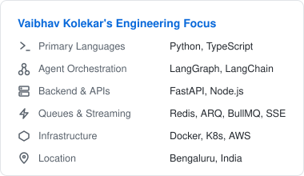

# Hi, I'm Vaibhav Kolekar

### AI, Backend & Distributed Systems Engineering

- 🔭 Currently building [**Autage**](https://github.com/va18hav/Autage)
- ⚡ Built [**Interviu**](https://interviu.pro) & [**Pingdeck**](https://app.pingdeck.xyz)
- 💬 Into **agentic systems**, **end-to-end systems**, **distributed systems**, and **LLMs**
- 🌐 Portfolio & projects at [**vaibhavk.devs.surf**](https://vaibhavk.devs.surf)
- 📫 Reach me at [**va18havrk3@gmail.com**](mailto:va18havrk3@gmail.com)
- 💻 Connect with me on [**LinkedIn**](https://linkedin.com/in/vaibhav-k-968883385)

 

## Core Stack

> Languages, frameworks, and infrastructure I use most often.

<table>
  <tr>
    <td align="center" width="96">
       
      Python
    </td>
    <td align="center" width="96">
       
      TypeScript
    </td>
    <td align="center" width="96">
       
      LangGraph
    </td>
    <td align="center" width="96">
       
      FastAPI
    </td>
    <td align="center" width="96">
       
      Node.js
    </td>
    <td align="center" width="96">
       
      PostgreSQL
    </td>
    <td align="center" width="96">
       
      Redis
    </td>
    <td align="center" width="96">
       
      Kubernetes
    </td>
  </tr>
</table>
